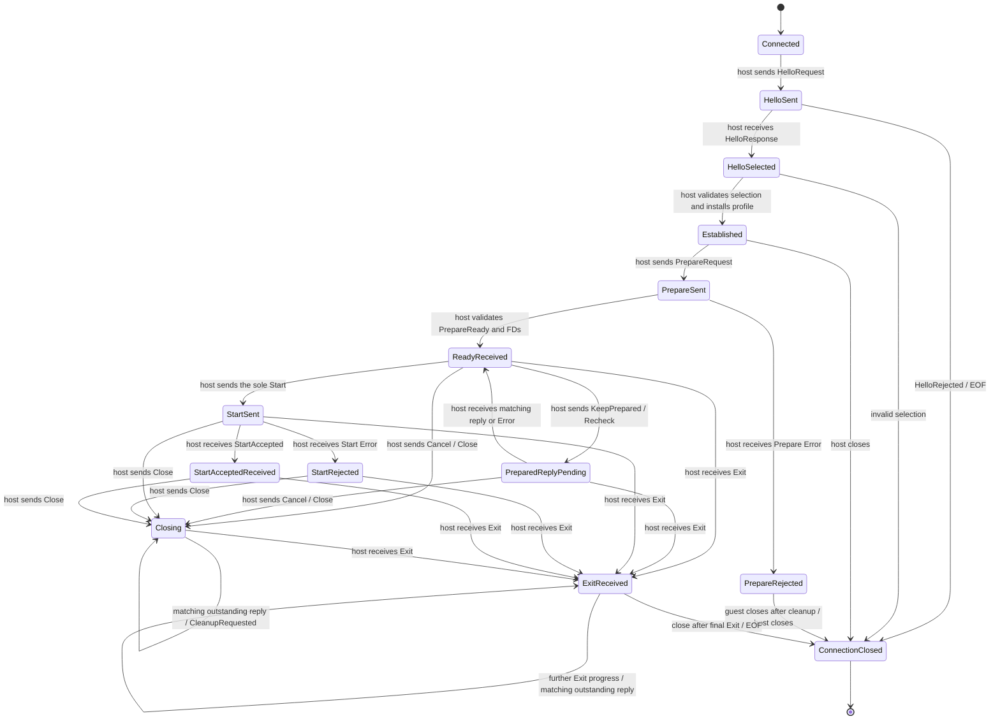

# Lasper guest protocol

`lasper-guest-protocol` defines the protocol used to run commands in a Lasper guest. Both the host client and guest runtime use its codecs and validation rules. The crate is `no_std` and requires no allocator.

The crate validates messages but does not open sockets or manage processes. Those operations belong to [`guest-host-transport`](../guest-host-transport/README.md) and [`guest-runtime`](../guest-runtime/README.md).

This README specifies the wire protocol. [COMPATIBILITY.md](COMPATIBILITY.md) describes how Hello selects the version and capabilities used by a connection.

The [wire state machine](#wire-state-machine) defines message order. Each message must also satisfy its selected profile's schema and capacity limits.

## Control frame format

The control connection is a Linux `AF_UNIX` socket of type `SOCK_STREAM`. Each frame consists of a 32-byte header followed immediately by a UTF-8 JSON payload, which has no trailing NUL. The frame occupies `32 + payload_bytes` bytes, excluding ancillary data. Because the socket provides a byte stream rather than message boundaries, the receiver must use the declared length to separate frames. The sender must finish one frame before sending another in the same direction.

All multibyte integers are unsigned and encoded in little-endian order. The offsets in the header table are measured from the start of the frame.

| Offset | Length | Field | Value and validation |
| --- | --- | --- | --- |
| 0..7 | 8 | `magic` | ASCII `LSPGCTL1`, or `4c 53 50 47 43 54 4c 31`. |
| 8..9 | 2 | `framing_format` | A `u16` fixed at 1. |
| 10..11 | 2 | `message_kind` | A `u16` with one of the values listed below. |
| 12..13 | 2 | `protocol_major` | A `u16` containing the sender's advertised major version during Hello and the selected major version once established. |
| 14..15 | 2 | `protocol_minor` | A `u16` containing zero during Hello and the selected minor version once established. |
| 16..23 | 8 | `request_id` | A `u64` used to associate requests with responses, as described under IDs and scope. |
| 24..27 | 4 | `payload_bytes` | A `u32` that counts only the encoded payload bytes. |
| 28..29 | 2 | `descriptor_count` | A `u16` that counts the FDs attached to this frame. |
| 30..31 | 2 | `reserved` | Both bytes must be zero. |

| `message_kind` | Message | `message_kind` | Message |
| --- | --- | --- | --- |
| 1 | `HelloRequest` | 7 | `Start` (request or acceptance response) |
| 2 | `HelloResponse` | 8 | `Cancel` (request or response) |
| 3 | `PrepareRequest` | 9 | `Close` (request or response) |
| 4 | `PrepareReady` | 10 | `Exit` |
| 5 | `KeepPrepared` (request or response) | 11 | `Error` |
| 6 | `Recheck` (request or response) | 12 | `HelloRejected` |

Before allocating storage for a payload, the receiver validates the header and checks its declared length and FD count against the applicable limits. The payload must contain exactly one JSON value that conforms to the message schema. Any bytes after the declared payload belong to the next frame.

If a message has an unknown kind or violates its schema, the receiver handles it according to the state machine's error rules. If framing fails, however, the receiver closes the connection rather than scanning for another occurrence of the magic bytes.

During the Hello exchange, `HelloRequest`, `HelloResponse`, and `HelloRejected` frames use the fixed bootstrap limits. Each complete frame may occupy at most 1024 bytes and must carry no FDs. Once the connection reaches the `Established` state, subsequent frames use the negotiated profile and limits. The [compatibility specification](COMPATIBILITY.md#hello-wire-format-and-connection-state) defines the fields used to advertise support, select a profile, or reject negotiation.

## Control capacities and Hello

A `ControlLimits` value is encoded as a JSON object with the two required fields below. Each endpoint advertises what it can accept through the `limits` field in its offer. The guest then places the limits selected for the connection in `HelloResponse.selected.limits`.

| JSON field | Integer type | 1.0 default offer | Meaning |
| --- | --- | --- | --- |
| `max_control_frame_bytes` | u32 | 1048576 | Total bytes per frame, including the 32-byte header |
| `max_descriptors` | u16 | 4 | `SCM_RIGHTS` FDs per frame |

Profile 1.0 permits a frame limit in `4096..=1048576` and an FD limit in `0..=4`. For each limit, negotiation takes the minimum of the values advertised by the two endpoints and the ceiling registered in the profile. If the resulting frame limit is below 4096 bytes, negotiation fails. Otherwise, the selected limits apply in both directions, so each endpoint must check the frames it sends as well as those it receives.

Profile 1.0 sets `max_control_descriptors` to 4 as a hard ceiling. By contrast, `MAX_CONTROL_DESCRIPTORS` determines how much ancillary storage the build reserves across all supported profiles; its current value is also 4. A particular connection may negotiate a smaller limit through `selected.limits.max_descriptors`. The bootstrap exchange has its own limit of zero FDs.

Although negotiation can succeed with an FD limit below three, a preparation requires enough capacity for every FD in its `PrepareReady` response. Terminal execution requires three FDs, whereas piped execution requires four. A limit of three therefore permits only terminal execution.

The guest checks this requirement before creating a worker. If capacity is insufficient, it rejects the preparation with an `Error` response whose code is `InvalidRequest`; it must not omit FDs or distribute them across several frames. The host API checks the same requirement before sending the request and reports a [capacity error](../guest-host-transport/README.md#errors-and-cancellation).

## IDs and scope

| ID | Format and issuer | Receiver validation | Cross-connection comparison | After disconnect |
| --- | --- | --- | --- | --- |
| `request_id` | The host assigns a `u64` to each request, including Hello. Values increase strictly within a connection and never wrap. | The guest checks request order. The host matches each response to the ID, kind, and operation of a sent request. | The same value may be used on different connections without implying a relationship. | Request correlation ends with the connection; requests cannot be replayed. |
| `broker_id` | At startup, the broker obtains 16 random bytes from the kernel. It publishes the ID in `HelloResponse` and uses it for all connections in that instance. | The host checks replies and reports against the ID received during Hello. The guest checks it in control requests. | Equal IDs identify the same broker instance. | The ID may still identify that instance, but grants no authority over a disconnected session. A restart requires a new Hello exchange. |
| Broker generation | A generation is the broker instance identified by `broker_id`; it has no separate field or counter. | Both endpoints check it through `broker_id`. | The same ID denotes the same generation. | Closing a connection does not end a generation, but restarting the broker does. |
| `preparation_id` | The guest obtains 16 random bytes from the kernel for each preparation and first publishes them in `PrepareReady`. | Both endpoints bind the ID to the current connection and broker. Later messages check it according to their schemas. | It cannot be used to find a preparation on another connection, even if the bytes happen to match. | The ID becomes invalid for operations after disconnect; a new connection cannot refer to the old preparation. |

The `broker_id` and `preparation_id` fields are encoded as JSON arrays of exactly 16 integers, each in `0..=255`. Equality compares all 16 bytes. These identifiers associate messages with a broker instance and a preparation; they do not establish process identity. That check uses kernel credentials and the identity channel, with the worker pinned by its pidfd.

A response reuses the `request_id` of the request it answers. For example, a `HelloRejected` response uses the ID from the `HelloRequest`, and a `PrepareReady` response uses the ID from the `PrepareRequest`.

An `Exit` report also uses the original preparation request's ID, including when several reports describe cleanup progress. An `Error` response uses the ID of the request that was rejected; whether it includes `preparation_id` depends on that operation's schema. If the host exhausts the request ID space, it must close the connection rather than wrap around or reuse an ID.

## Sessions and data handoff

Each control connection is used to prepare one worker, for which the host may submit at most one `Start` request. The request and preparation IDs associate operations within that connection. If the connection closes, its guardian is responsible for cleaning up the worker and its descendants.

A `PrepareReady` response transfers the following FDs through `SCM_RIGHTS`:

| Execution kind | Ready FD order | Count |
| --- | --- | --- |
| `Terminal` | PTY master, identity channel, worker pidfd | 3 |
| `Piped` | identity channel, worker pidfd, stdout reader, stderr reader | 4 |

The receiver checks that the FD count and each descriptor's role match the requested execution kind. For piped execution, the worker reads stdin from `/dev/null` and writes stdout and stderr to separate pipes. Output travels through these descriptors, while `Exit` reports carry only status.

A `StartAccepted` response confirms that the guest accepted the `Start` request, but the eventual `ExitReport` establishes the outcome of `execve`. The PTY itself can be read or written as soon as the host receives it in `PrepareReady`. Because the control protocol does not gate access to data FDs, bytes written before execution may remain in the terminal input buffer for the program to consume.

### SCM_RIGHTS anchor and reception

The payload and FDs in a `PrepareReady` response belong to the same control frame. The sender attaches a `SOL_SOCKET / SCM_RIGHTS` record to the first byte of its header: the `L` at offset zero. This byte is the anchor for FD reception, rather than an extra byte or a separate frame. Accordingly, `CONTROL_FRAME_DESCRIPTOR_ANCHOR_BYTES` is 1, and the receiver reads that byte separately before reading the rest of the header.

The `sendmsg` call that transmits the first byte must carry all FDs in a single `SCM_RIGHTS` record, in the order specified above. That call may also transmit the rest of the frame. If further writes are needed, they must carry bytes only, without repeating the ancillary record. Every control message other than `PrepareReady` must set `descriptor_count` to zero.

For each frame, the receiver first calls `recvmsg` to read exactly one byte and collect its ancillary data. It then reads the remaining 31 header bytes and the declared payload, while continuing to check for ancillary data on those later reads.

The receiver must close the connection if FDs arrive anywhere except the anchor, if it receives more than one `SCM_RIGHTS` record, or if a record is empty or has another ancillary type. It must also reject `MSG_CTRUNC`, `MSG_TRUNC`, and any mismatch between the received count and `descriptor_count`. In all of these cases, it closes every FD it has received. Reception uses `MSG_CMSG_CLOEXEC` so that unrelated calls to `execve` cannot inherit the descriptors.

As soon as `recvmsg` installs FDs, the receiver becomes responsible for closing them. It must retain them until it has validated the complete frame and checked their count, order, and roles. If validation or a later read fails, or if reception is cancelled or reaches EOF, it closes every FD installed for that frame. This rule also applies when ancillary data is truncated: the receiver must release every installed FD returned by the kernel, even if more than three or four arrived.

### Partial sends and ownership

Passing an FD through `SCM_RIGHTS` gives the receiver a new reference to the same open file description; the sender still owns its original reference. The kernel assigns a descriptor number in the receiver's process, so that number is neither included in the payload nor compared with the sender's descriptor number.

| Send or receive progress | FD state and closure responsibility |
| --- | --- |
| The first `sendmsg` call has not written a byte, including when it returns `EINTR` or `EAGAIN`. | The call has not delivered the FDs. The sender retains them and retries from the same offset with the same ancillary record. |
| The first `sendmsg` call returns a positive byte count, even if the header is incomplete. | The kernel has accepted the FDs with the first byte. The sender records the new offset and sends the remaining bytes without attaching the FDs again. |
| The receiver has read the anchor but not the complete frame. | The receiver temporarily owns the installed FDs. Closing the sender's references cannot revoke them. |
| Transmission or reception fails or is cancelled after the first byte. | The connection is discarded. The receiver closes installed FDs, the kernel releases any unread references when the queue is destroyed, and the sender closes its temporary copies. |
| The receiver has validated the frame and FDs. | The receiver owns the delivered descriptors. Each endpoint then retains or closes its own references according to their roles. |

After a short write, the sender continues from the number of bytes already written. It must not restart the frame or resend `PrepareReady` after the first byte has been sent. If transmission cannot continue, closing the connection triggers cleanup in the guest.

Even a complete socket write proves only that the sender finished transmitting the frame. The host can use the delivered descriptors only after it has received and validated the entire response.

## Wire state machine

The diagram below describes the exchange from the host's perspective. Each state determines which frames may follow, while the guest processes requests in the order in which it receives them.

`ControlConnectionState` validates the Hello exchange and checks subsequent frame headers against the negotiated profile. After negotiation, `WireSessionState` governs the order of session messages; both the host driver and the guest control loop use its transition rules.

The session state tracks the preparation request, the single attempt to start execution, and any requests that still await responses. This allows it to match replies even when a `Close` request or an `Exit` report overlaps with an earlier exchange. Before a response reaches this state machine, its codec must validate the payload, preparation binding, and FD roles.

Before queueing a request, the sender checks whether the current state permits it. It commits the transition only after writing the complete frame. If an `Exit` report arrives while that request is queued, the state machine must still account for its possible response, without allowing new operations on the session.

On the guest, the state machine registers a request after receiving its complete frame and commits the result after sending the complete response. The guardian separately tracks whether the worker can still start and whether its lease or cleanup has completed. Those decisions depend on process resources, so they cannot be inferred from wire state alone.



A send event in the diagram occurs only when the entire frame has been written to the control socket. If the connection fails during transmission or before a response is complete, the disconnect rules below apply. Any state that is not terminal may transition to `ConnectionClosed` after a disconnect or a fatal protocol error.

The `HelloSelected` state represents validation performed locally by the host. The guest enters `Established` after sending its `HelloResponse`, whereas the host enters that state only after validating the selection. No additional acknowledgement is exchanged. Once installed, the selected profile remains fixed for the connection.

### Frames allowed in each state

Every response must match the ID, kind, and operation of the request it answers. Once the broker and preparation IDs are known, those fields must match as well. An `Exit` report is associated with the original `PrepareRequest`, so it may arrive even when no operation is waiting for a response. On the wire, `StartAccepted` is a response to `Start` rather than a separate message kind.

| State | host → guest | guest → host and next state |
| --- | --- | --- |
| `Connected` | The host may send one `HelloRequest`. | The guest waits for that request; no session operation is allowed yet. |
| `HelloSent` | The host waits for negotiation to finish. | A `HelloResponse` moves the host to `HelloSelected`; a `HelloRejected` response ends the connection. |
| `HelloSelected` | The host sends no request while validating the selection. | Successful validation leads to `Established`; failure closes the connection. Any extra response is a protocol error. |
| `Established` | The host may send one `PrepareRequest` or close the connection. | The guest waits for the request without sending unsolicited messages. |
| `PrepareSent` | The host waits for the preparation result. | A valid `PrepareReady` response and its FDs lead to `ReadyReceived`; an error response leads to `PrepareRejected`. |
| `PrepareRejected` | The host closes the connection. | The guest releases allocated resources and closes, without sending `PrepareReady` or `Exit`. |
| `ReadyReceived` | `KeepPrepared` or `Recheck` leads to `PreparedReplyPending`. `Start` leads to `StartSent`, while `Cancel` or `Close` leads to `Closing`. | An `Exit` report leads to `ExitReceived`. |
| `PreparedReplyPending` | The host waits for the pending response, but may send `Cancel` or `Close`. | A matching response or error returns the connection to `ReadyReceived`. An `Exit` report instead leads immediately to `ExitReceived`. |
| `StartSent` | The host waits for the start response, but may send `Close`. | Acceptance leads to `StartAcceptedReceived`, rejection to `StartRejected`, and an exit report to `ExitReceived`. |
| `StartRejected` | The host may send `Close` to enter `Closing`. | The guest sends the corresponding response and exit reports. It rejects other operations, including a second start, with `InvalidState`. |
| `StartAcceptedReceived` | The host may send `Close` to enter `Closing`. | The guest sends `Exit` when the worker exits or cleanup begins. |
| `Closing` | The host sends no new request. | The host accepts outstanding responses, including the cleanup acknowledgement, and exit reports. |
| `ExitReceived` | The host sends no new request. | The host accepts matching outstanding responses and further exit reports. A report whose `cleanup` field is `Complete` is final and is followed by closure. |
| `ConnectionClosed` | No frame may be sent. | No frame may be received. |

Before sending a `KeepPrepared`, `Recheck`, or `Start` request, the host must wait for the preceding request's response. It may, however, send `Cancel` or `Close` while that response is still outstanding. Each request retains its own ID, so a reply to the earlier request cannot acknowledge the cleanup request. The host may submit `Start` at most once on a connection.

Once cleanup begins, the guest stops dispatching new session operations and sends any responses it has already queued before sending `Exit`. Requests that arrive during cleanup do not restart an operation or extend the cleanup period. Meanwhile, the host continues to validate replies to outstanding requests even though its state is `Closing`.

Receiving any valid `Exit` report moves the connection to `ExitReceived`. This includes reports caused by lease expiry or by a worker exiting before `Start`, as well as reports that arrive before `StartAccepted`. Cleanup remains in progress until a report sets `cleanup` to `Complete`. Acknowledgement of `Start` and confirmation of execution remain separate facts: the former comes from `StartAccepted`, and the latter from the report's `execution` field.

### Unexpected frames and error replies

Before dispatching a frame according to session state, the receiver must validate its header, payload length, and attached FDs. If that validation fails, it closes every FD attached to the frame.

| Condition | Action |
| --- | --- |
| The magic or framing is unrecognized, the frame is truncated or exceeds capacity, or the FDs have an invalid count or role. | The receiver closes the connection, and the guest cleans up allocated resources. |
| A Hello message arrives after negotiation, or a frame uses a version different from the selected profile. | The receiver closes the connection and triggers cleanup without renegotiating. |
| A message has the wrong direction or is absent from the profile, or the host receives an unmatched or duplicate response. | The receiver treats this as a protocol error and closes the connection. |
| The guest recognizes an operation but its request has invalid fields, an invalid ID, or an incorrect preparation binding. | The guest sends an `Error` response with code `InvalidRequest`, without performing the operation. |
| The request is valid but the current state disallows it, as with a second preparation or a repeated start. | The guest sends an `Error` response with code `InvalidState`, without performing the operation. |
| A new request arrives after guest cleanup begins. | The guest continues cleanup and sends only already-queued responses and exit reports. |
| The host receives a matching `Error` response. | The host records rejection of that operation. Preparation and start requests follow the transitions above; rejection of a lease renewal or recheck does not itself constitute an exit report. |

Sending an `Error` response does not change the current execution or cleanup state. Lease expiry or worker exit may still trigger cleanup independently. If the guest cannot identify the operation or safely decode the request, it closes the connection instead of replying. Rejection during negotiation follows the [Hello wire contract](COMPATIBILITY.md#hello-wire-format-and-connection-state).

### Disconnect and cleanup

The guest follows the same cleanup path whether it observes EOF, an unrecoverable I/O error, or an explicit close. When the host detects a protocol error, it closes the connection so that this cleanup path runs in the guest.

| Stage at disconnect | Guest action |
| --- | --- |
| Before the guest begins processing a preparation request. | The guest releases connection resources; no worker exists. |
| Preparation has begun, but its response has not been delivered. | The guest cancels preparation and reclaims any worker and resources it created. |
| The preparation response was delivered, but execution has not been accepted. | The guest cleans up the prepared worker and closes its identity channel and data endpoints. |
| Execution was accepted, even if the host has not received `StartAccepted`. | The guest stops the worker and cleans up the session. |
| Cleanup has begun, but the final report has not been sent. | The guest continues the existing cleanup. |
| The final report has been sent. | The guest releases the remaining connection resources. |

The guardian remains responsible for its worker after the connection is lost. It must stop that worker and reclaim the session's resources without waiting for the host to reconnect or send a `Close` request. If cleanup has already begun, the guardian continues it.

### Observability of cleanup

The host can confirm cleanup only after it has received and validated a final `Exit` report on the original connection, with `cleanup` set to `Complete`. Successfully sending the report does not prove that the host received it. If the frame is truncated in transit, cleanup therefore remains unconfirmed from the host's perspective.

After disconnect, the guardian continues cleanup but has no channel through which to report its result to the host. A new connection cannot retrieve reports from the old session. Consequently, the absence of a final report means that cleanup is unconfirmed; it does not establish that cleanup failed. Conversely, a final report that the host validated before disconnect remains valid afterward.

| Observable event | Established fact |
| --- | --- |
| The host validates a final `Exit` report with `cleanup` set to `Complete` on the original connection. | Cleanup of that session is complete. |
| The connection closes after a nonfinal report. | Only the progress in that report is confirmed; the final result remains unknown. |
| The host receives status `CleanupRequested` after sending `Close`, then loses the connection. | The guest accepted the cleanup request, but completion remains unconfirmed. |
| The worker pidfd becomes readable, output reaches EOF, or the PTY hangs up. | The worker exited or a data endpoint closed. This does not confirm cleanup of all session resources. |
| A probe succeeds on a new connection. | The current broker is reachable and can complete Hello. This establishes nothing about the old session's cleanup. |
| Broker capacity becomes available again, or a guardian writes a log. | These events can aid diagnosis, but do not provide a wire confirmation for the original session. |

A deadline expiring on the host also says nothing about the guest's cleanup result. The host API records this lack of confirmation in `Completion.error`, as described under [states and completion](../guest-host-transport/README.md#states-and-completion).

Closing the control connection does not close data FDs that have already been delivered to the host, and retaining those FDs does not prevent cleanup in the guest. For pipes, buffered bytes remain readable after all writers close, followed by EOF once the buffer is empty. A Linux PTY master may instead report `EIO` after a hangup.

## Messages and fields

The table below lists the fields in profile 1.0. The header carries `request_id`; the other fields belong to the JSON payload. A question mark indicates an optional field. Each codec also checks the constraints on arrays and enum values, including whether a field is allowed for the chosen execution kind.

| Message and direction | `SchemaId` | Payload fields and constraints |
| --- | --- | --- |
| `PrepareRequest`, host → guest | `PrepareV1` | Required: `user`, `execution`, `process`, `environment`. Optional: `initial_size`. The `process` field selects a login shell or a command with arguments. See [execution encoding](#execution-kind-encoding) and [environment](#environment-wire-contract) for field constraints. |
| `PrepareReady`, guest → host | `ReadyV1` | `broker_id`, `preparation_id`, `remaining_lease_ms`. The response carries three or four FDs, depending on the requested execution kind. |
| `KeepPrepared`, `Recheck`, `Cancel`, or `Close` request, host → guest | `ControlRequestV1` | `broker_id`, `preparation_id`. |
| Response to one of those control requests, guest → host | `ControlReplyV1` | `broker_id`, `preparation_id`, `status`. See [control replies](#control-replies-and-cancellation) for the status allowed by each operation. |
| `Start` request, host → guest | `StartV1` | Required: `broker_id`, `preparation_id`. Optional: `terminal_size`, `execution_timeout_ms`. The timeout field requires `EXECUTION_TIMEOUT`. |
| `Start` acceptance response, guest → host | `StartAcceptedV1` | `broker_id`, `preparation_id`. The response carries no FDs. |
| `Exit`, guest → host | `ExitV1` | Required: `broker_id`, `preparation_id`, `execution`, `cleanup`, `reason`. Optional: `exit`, `failure`. The report contains no output. |
| `Error`, guest → host | `ErrorV1` | Required: `broker_id`, `operation`, `code`. Optional: `preparation_id`, `errno`, `stage`. The codec checks which combinations are valid for the operation and error code. |

The `StartAccepted` response uses `MessageKind::Start`, just as other control responses reuse their request's message kind. A codec is therefore selected by both kind and direction. Its `SchemaId` also determines which values are valid for `ExitReason`, `ExecutionStatus`, `GuestErrorCode`, and the failure stage.

An enum variant with no associated data is encoded as a JSON string; an object such as `{"variant":null}` is invalid. This applies wherever a schema uses a unit variant, including execution kinds, `login_shell`, and `cleanup_requested`. Variants that carry data use the object encoding defined by their schema.

A preparation is bound to the broker identified during the Hello exchange. The local `PrepareRequestFrame` retains that `broker_id` so that the host can check the `PrepareReady` response and all subsequent replies.

The `IdentityV1` schema defines a challenge containing `preparation_id` and `nonce`. Its reply contains `preparation_id`, `challenge`, `guest_user`, `guest_uid`, and `guest_gid`. Although the identity exchange uses a separate channel, its schema is selected by the same profile as the control connection.

### Execution kind encoding

The `ExecutionKind` enum specifies how the worker's I/O is prepared. It has two variants, `Terminal` and `Piped`, which the required `execution` field in `PrepareV1` encodes as follows:

| `ExecutionKind` | execution JSON value | `PrepareV1`.`initial_size` | `PrepareReady` FD count |
| --- | --- | --- | --- |
| `Terminal` | `"terminal"` | A valid `TerminalSize` is required. | 3 |
| `Piped` | `"piped"` | The field must be absent. | 4 |

The guest rejects any other spelling, including `"interactive"`, `"bounded"`, and differently capitalized values, with an `Error` response whose code is `InvalidRequest`. A null value is also invalid. For terminal execution, `initial_size` must be present and non-null; for piped execution, it must be absent.

The execution kind is fixed during preparation and cannot be changed by `Start`. Similarly, the `terminal_size` field in `StartV1` is allowed only for terminal execution.

The `execution` field in `ExitV1` has a different purpose: it reports the outcome of execution through `ExecutionStatus`. It does not use the `ExecutionKind` enum found in `PrepareV1`.

## Control replies and cancellation

A successful response to `KeepPrepared`, `Recheck`, `Cancel`, or `Close` reuses the request's kind and ID. Its payload contains `broker_id`, `preparation_id`, and `status`, and the frame carries no FDs. The `status` field uses one of the following exact JSON encodings:

| status | JSON value | Meaning |
| --- | --- | --- |
| `Prepared` | `{"prepared":{"remaining_lease_ms":45000}}` | The preparation remains valid after the operation. The number gives its actual remaining lease. |
| `CleanupRequested` | `"cleanup_requested"` | The request caused cleanup to begin, but does not confirm that it is complete. |

For the `Prepared` variant, the outer object contains only `prepared`, whose value is an object containing only `remaining_lease_ms`. That field is a `u32` in `1..=selected_profile.capacities().max_prepared_lease_ms`; profile 1.0 permits up to 300000 ms, and the default guest lease is 45000 ms. The `CleanupRequested` variant is encoded as a string without an object wrapper.

The receiver closes the connection if the status is unknown, contains extra fields, reports an invalid lease, or does not match the request's operation. If an operation fails, the guest sends an `Error` response rather than encoding the failure in `status`.

The phases in the next table describe the guest's execution state when it processes a request. They do not depend on whether the host has received `StartAccepted`.

A worker is prepared once its `PrepareReady` response has been delivered, provided that its lease is still valid and the guest has not accepted `Start`. After acceptance, it is starting until the guest confirms the result of `execve`; successful execution then makes it running. Once the guardian begins cleanup, the worker is in the cleaning phase.

| Operation | Prepared | Starting / Running | Only valid success status |
| --- | --- | --- | --- |
| `KeepPrepared` | The guest renews the lease from the time it processes the request, using its configured duration of 45000 ms by default. | The guest rejects the request with `InvalidState`, without changing execution. | `Prepared` |
| `Recheck` | The guest confirms validity and reports the remaining lease without renewing it. | The guest rejects the request with `InvalidState`, without changing execution. | `Prepared` |
| `Cancel` | The guest cancels the unstarted worker and begins cleanup with reason `Cancelled`. | The guest rejects the request with `InvalidState`; accepted execution is not stopped. | `CleanupRequested` |
| `Close` | The guest ends preparation and begins cleanup with reason `ClientClosed`. | The guest stops the worker and begins cleanup with reason `ClientClosed`. | `CleanupRequested` |

A successful `Recheck` response confirms that the preparation remains valid; checking the worker's identity requires a separate challenge and reply. The guest measures `remaining_lease_ms` when it constructs a response to `KeepPrepared` or `Recheck`, or the initial `PrepareReady` response. This measurement uses its monotonic clock and excludes the time spent transmitting the response.

The guest chooses the lease duration under its local policy, up to 300000 ms for profile 1.0, while the host schedules renewal from the reported remainder. See [budgets and guest policy](../guest-host-transport/README.md#wait-budgets-and-guest-policy) for configuration. Once the guest accepts `Start`, the prepared lease no longer limits execution.

The order in which the guest processes `Cancel` and `Start` determines their outcome. If it processes `Cancel` first, it begins cleanup and does not execute a later `Start`. If it accepts `Start` first, it rejects `Cancel` with `InvalidState`, even if the host has not yet received `StartAccepted`. To stop a worker after acceptance, the host must send `Close`; the guest never treats `Cancel` as an implicit `Close`.

If the guest rejects `Start`, the connection enters `StartRejected` rather than returning to `ReadyReceived`. From that point, only `Close` is allowed, even if the worker has not executed and its lease remains valid. The guest rejects other operations with `InvalidState`. This connection-level restriction takes precedence over the execution phases in the table.

Before processing an operation, the guest checks whether the prepared lease has expired. If it has, the guardian begins cleanup with the reason `LeaseExpired`, without renewing the lease, starting the worker, or acknowledging a new operation. If worker exit or another event has already triggered cleanup, that existing cleanup continues instead.

While cleaning, the guest no longer dispatches requests, including repeated `Cancel` or `Close` requests. It sends only responses that were already queued and its `Exit` reports, preserving the reason that first triggered cleanup. These rules override the normal responses in the table.

The guest sends a response with status `CleanupRequested` before the `Exit` report caused by that request. Further reports may describe progress until a final report sets `cleanup` to `Complete`. If the connection is lost first, the disconnect rules apply.

When both `Close` and `Start` are outstanding, the response to each retains its own request ID. In particular, the response acknowledging cleanup uses the ID from `Close`, while the acceptance or rejection of execution uses the ID from `Start`.

## Environment wire contract

The `environment` field in a preparation request supplies variables that the guest merges with the account's defaults before execution.

### Encoding and validation

The `environment` field is required and must be a JSON list. Each entry is an object with two string fields, `name` and `value`. If the caller supplies no variables, the encoder emits `[]`. The guest rejects a missing field, a null value, or a JSON object in place of the list with `InvalidRequest`. For example, a valid list is:

```json
{
  "environment": [
    { "name": "NOTE", "value": "first line\nsecond line" },
    { "name": "TERM", "value": "" }
  ]
}
```

A variable's `name` is case-sensitive and must match `[A-Za-z_][A-Za-z0-9_]*`. Its `value` is a UTF-8 string that may be empty or contain newlines. Neither field may contain a decoded NUL, including one written as `\u0000` in JSON.

Entries must appear in strictly increasing lexicographic order when their decoded names are compared as ASCII bytes. This ordering also ensures that each name appears only once. If adjacent names are equal or out of order, the guest rejects the request with `InvalidRequest`, regardless of their values. A variable may nevertheless share a name with an account default, in which case it overrides that default.

The encoder must produce this order rather than relying on the decoder to sort the input. The decoder checks each name against the previous one and rejects the request as soon as their ordering is invalid. Because the comparison uses decoded names, `A` and `\u0041` refer to the same variable. An empty list or a list with one entry satisfies the ordering rule.

Profile 1.0 requires this representation so that encoding is deterministic and the guest can validate uniqueness in one pass. The host API uses a `BTreeMap`, which already supplies the required order. Any other encoder must produce the same ordering.

### Additional environment capacity

Let `c = selected_profile.capacities()`. Both endpoints use `c.environment_entries` to limit the number of additions and `c.environment_bytes` to limit their decoded size. Profile 1.0 registers the values below; another minor uses the capacities registered in its own `ProfileCapacities`.

| `ProfileCapacities` field | 1.0 value |
| --- | --- |
| `environment_entries` | 32 |
| `environment_bytes` | 16 * 1024 |

Every supplied entry counts toward these limits, including an entry that overrides a default. The byte budget measures the decoded additions using the formula below. Account defaults are counted separately.

```text
extra_bytes = sum(UTF8_bytes(name) + 1 + UTF8_bytes(value) + 1)
                                      '='                  NUL
```

The calculation includes a terminating NUL for each entry. For example, an empty list uses zero bytes, while an entry with name `TERM` and an empty value uses six. A JSON escape such as `\n` contributes one decoded byte. The host checks these limits before submission, and the guest checks them again during decoding; exceeding either limit results in `InvalidRequest`.

### Decode scratch and request storage

The decoder reuses a scratch buffer for each string rather than retaining a decoded copy of every string. The required size follows from the selected [profile capacities](COMPATIBILITY.md#minor-and-schema-manifest), although arguments and environment entries are still validated against their separate field limits.

```text
c = selected_profile.capacities()
prepare_unescape_bytes = max(c.command_argument_bytes, c.environment_bytes)
merged_environment_bytes = c.default_environment_bytes + c.environment_bytes
environment_pointer_slots = 6 + c.environment_entries + 1

# Derived values for 1.0
prepare_unescape_bytes = 16 * 1024
merged_environment_bytes = 32 * 1024
environment_pointer_slots = 39
```

These formulas use the selected profile's capacities. Constants whose names begin with `MAX_` describe storage reserved by the build and must not replace those capacities when validating a connection.

The scratch requirement counts decoded UTF-8 bytes, while the original JSON escapes remain in the received payload. Scratch does not need space for C string terminators because the storage used to build the execution environment supplies the NUL in `name=value\0`.

The `NegotiatedProtocol` methods `decode_prepare`, `decode_prepare_frame`, and `decode_prepare_into` all accept scratch supplied by the caller. Each validates the request using the connection's profile, enabled features, and effective frame limit. The guardian uses `decode_prepare_into`, which also constructs request metadata in a caller-owned `PrepareDecodeStorage`. If the supplied scratch is too small, decoding returns a local storage-capacity error.

The codecs pass this buffer through their calls rather than creating fixed arrays inside decoder functions. For profile 1.0, the guardian maps 64 KiB before decoding: 16 KiB for scratch, with the rest reserved for metadata. The mapping accommodates systems with 4, 16, or 64 KiB pages. String visitors borrow their input before validating it, so recursive visitor calls do not place 16 KiB arrays on the stack.

The decoded request retains borrowed views of the name and value for each environment entry, up to `c.environment_entries` pairs. Each view refers to a slice of the original payload, whether that slice contains plain text or JSON escapes. The decoder uses scratch to check the decoded length and characters. To check ordering, it decodes the previous name's view byte by byte and compares it with the current name in scratch; it therefore needs neither another name buffer nor a smaller limit on name length.

Because the returned request borrows only the payload held by `PrepareStorage`, it does not depend on scratch after validation. `PrepareStorage` remains alive through cleanup, whereas `PrepareDecodeStorage` is released once validation returns.

When the worker builds its execution environment, it decodes the retained payload views again. It uses a separate mapping that contains both `prepare_unescape_bytes` of scratch and `merged_environment_bytes` of storage for the merged environment. These regions occupy 16 KiB and 32 KiB respectively in profile 1.0. Keeping them separate prevents decoding a later string from overwriting an entry that has already been constructed.

### Prepare metadata workspace bound

The 48 KiB metadata budget for profile 1.0 accounts for objects that may be alive at the same time. String contents remain in the payload held by `PrepareStorage`; the decoder retains only the views and metadata needed to interpret them. It does not copy the full 64 KiB of arguments or 16 KiB of environment contents into this region.

At maximum capacity, a request contains 257 argument views, including the executable, plus 32 pairs of environment names and values. This gives 321 string views in total. Whether a view contains plain or escaped text, its `size_of` must not exceed 32 bytes and its `align_of` must not exceed 16. These bounds give the following layout:

| Per-request component | 1.0 bound |
| --- | --- |
| argv views | 257 × 32 = 8224 bytes |
| Environment name/value views | 32 × 2 × 32 = 2048 bytes |
| Other fields, lengths, discriminants, and all padding | 1024 bytes |
| Calculated complete request metadata bound | 11296 bytes |
| Allocated complete request slot | 16 `KiB` |

The allowance for other fields includes `user`, `execution`, the process discriminant, `initial_size`, container lengths, and all padding. Layout checks apply to the complete `WirePrepareRequest` and validated `PrepareRequest`, rather than just their view arrays. Since both requests may coexist during conversion, the budget reserves a full slot for each without relying on the compiler to eliminate copies.

| Metadata region | Capacity |
| --- | --- |
| `WirePrepareRequest` slot | 16 `KiB` |
| Validated `PrepareRequest` slot | 16 `KiB` |
| Explicit `DecoderWorkspace` for visitors, field access, and conversion | 8 `KiB` |
| Reserved headroom | 8 `KiB` |
| Total | 48 `KiB` |

Both requests and the `DecoderWorkspace` are constructed in place within the mapping. Any temporary object whose size grows with the argument or environment count must also fit in these regions; visitor stack frames must not hide another complete request or an equivalent array. With scratch stored separately, the full mapping for profile 1.0 occupies 16 KiB + 48 KiB = 64 KiB.

The layout module checks concrete types at compile time. A string view must fit within 32 bytes, each request within 11296 bytes, and the `DecoderWorkspace` within 8192 bytes; none may require alignment greater than 16. After alignment, the three regions must not overlap and must fit within 48 KiB, or 64 KiB when scratch is included. These assertions are compiled for each guest architecture, so a type that exceeds its allowance causes the build to fail.

The layout fixture fills both decoded-byte budgets with escaped content and uses the maximum number of argument and environment views. It also supplies the longest permitted account name and an initial terminal size. Decoding takes place in exactly 64 KiB of `PrepareDecodeStorage`, with canaries that detect writes beyond the allocated regions. Separate cases exercise a login shell and piped execution. These checks retain the bounds for profile 1.0 even when a later profile requires a larger layout.

### Merge and exec storage

The guest first constructs the account's default environment. For terminal execution, it also sets `TERM=dumb`; piped execution receives no default `TERM`. It then applies the caller's entries in wire order, replacing any variable with the same name. As a result, each name occurs only once in the environment passed to `execve`.

If the caller omits `TERM`, the default for the chosen I/O mode remains in effect. By contrast, `{ "name": "TERM", "value": "" }` explicitly overrides it with an empty value, producing `TERM=\0`. An empty value has the same overriding meaning for every other variable.

Account defaults are limited by `c.default_environment_bytes`, which is 16 KiB in profile 1.0. This allowance covers `HOME`, `USER`, `LOGNAME`, `SHELL`, `PATH`, and the default `TERM` for a PTY. Storage for account fields and the fixed `PATH` must accommodate those defaults.

The merged environment occupies at most `merged_environment_bytes`, with each terminating NUL counted in its respective budget. Its pointer array has `environment_pointer_slots` entries: up to six defaults, `c.environment_entries` additions, and one final null pointer. Profile 1.0 therefore requires 32 KiB for strings and 39 pointer slots.

The worker uses independent storage for this merge and validates defaults and caller additions against their respective limits. If it cannot allocate that storage, it reports a resource failure at the appropriate setup stage.

### Guest memory and stack budgets

The table below gives the storage budgets for profile 1.0. When a new profile changes capacity, its workspace requirements must be derived from those capacities and checked against the mapping layout. A build that supports larger profiles may reserve more storage, but this must not change what profile 1.0 accepts or how much storage it requires.

| Storage | Capacity and owner | Lifetime |
| --- | --- | --- |
| Preparation payload | `PrepareStorage` maps the declared payload length, subject to the negotiated frame limit. | From reception until session cleanup ends. |
| Workspace for decoding preparation | The guardian owns a 64 `KiB` `PrepareDecodeStorage` mapping, including 16 `KiB` of scratch for unescaping strings. | While the request is decoded and validated. |
| Worker's base workspace | The worker owns 192 `KiB` through `WorkerMemory`. | From worker preparation until execution or exit. |
| Worker's environment storage | The worker owns a separate 64 `KiB` mapping, which contains 16 `KiB` of scratch, 32 `KiB` for merged strings, 39 pointers, and padding. | From worker preparation until execution or exit. |
| Stack for each guardian or worker | `WORKER_STACK_BUDGET_BYTES` reserves a budget of 1 `MiB`. | While that process runs runtime code. |

The worker's dedicated workspaces total 256 KiB. The payload mapping is accounted for separately in the guardian's address space and in the worker's address space after the fork. The guardian releases its decoding workspace before creating the worker, and additional large arrays reside in mappings rather than on the stack. Separate `size_of` and `align_of` assertions check the layout of `PrepareDecodeStorage` and the worker's environment storage.

## Tests

Run the protocol tests from the repository root:

```sh
cargo test -p lasper-guest-protocol --locked
```

Tests live under `tests/`. They check encoded messages against their schemas and exercise the shared wire state machine. Socket I/O and process cleanup are tested in the crates that perform those operations.
